<!--
  ============================================================
  PRANAY KHODADE — DEVELOPER PORTFOLIO & ENGINEERING PROFILE
  GitHub Profile Repository: pranaykhodade1922-dot/pranaykhodade1922-dot
  ============================================================
-->

  

  
  &nbsp;
  
  &nbsp;
  
  &nbsp;
  

## 👨‍💻 Engineering Identity

<table>
  <tr>
    <td width="260" align="center" valign="top">
       
      
        
      <b>Pranay Khodade</b> 
      B.Tech CSE (Data Science) • 2nd Year 
      Full-Stack &amp; AI Product Builder
        
      
    </td>
    <td valign="top">
      <h3>Turning ideas into things people can use.</h3>
      

        I am a second-year <b>Computer Science and Engineering (Data Science)</b> student with a deep interest in full-stack architecture, agentic AI workflows, and applied software engineering.
      

      

        I don't look at software as just lines of code or a set of syntax rules. For me, engineering is about taking an ambiguous, real-world friction point—whether it's a street vendor struggling with bookkeeping during peak hours, a payment pipeline susceptible to automated abuse, or students looking for campus clarity—and structuring a dependable, well-tested product that actually solves it.
      

      

        My focus spans the entire product lifecycle: understanding the core problem, drafting system architectures, writing resilient backend and frontend code, participating in high-intensity hackathons, and contributing to open-source software.
      

      

      <h4>🔭 Currently Exploring &amp; Engineering</h4>
      <ul>
        <li><b>Agentic AI &amp; Human-in-the-Loop Workflows:</b> Designing autonomous reasoning pipelines that preserve user authority and zero silent side-effects.</li>
        <li><b>High-Precision Backend Systems:</b> Deterministic state management, transactional integrity, and integer-based financial calculations.</li>
        <li><b>Modern Full-Stack Applications:</b> Scalable web architectures with React, TypeScript, Node.js, and modern cloud databases.</li>
        <li><b>Defensive Security Architecture:</b> Input verification pipelines, guardrails for AI interfaces, and API safety layers.</li>
        <li><b>Open-Source Ecosystems:</b> Collaborating on real-world repositories and refining cross-platform UI responsiveness.</li>
      </ul>
    </td>
  </tr>
</table>

## 🚀 Featured Projects

A curated selection of products, hackathon builds, architecture experiments, and open-source contributions.

---

### 1. Vyapaar Saathi — Voice-First AI Financial Teammate
> **Flagship Hackathon Build • Paytm Build For India AI Hackathon (Mumbai Edition)**  
> *Autonomous Agentic Reasoning • Vernacular Voice Interaction • Deterministic Financial Mathematics*

  

* **Problem It Solves:** Local kirana store owners and street cart merchants handle fast-paced, continuous cash and UPI transactions. They rarely have the time or technical background to navigate complex accounting menus, ledger software, or cluttered dashboard UIs while attending to customers.
* **The Solution & Architecture:** Built a voice-driven financial assistant powered by a continuous 7-stage agentic loop:  
  `Observe → Reason → Propose → Approve → Act → Verify → Remember`.
* **Key Engineering Highlights:**
  * **Zero Floating-Point Drift:** All internal calculations and transaction tracking strictly operate in **integer paise** rather than standard floating-point numbers, eliminating rounding inaccuracies across cumulative merchant balances.
  * **Human-in-the-Loop Safeguard:** The AI proposes actions based on voice inputs and transaction history, but never executes a state change without explicit merchant verification.
  * **Asymmetric Architecture:** Heavy intelligence and reasoning occur on the backend, keeping the merchant's interface fast, accessible, and lightweight even on modest mobile devices.
* **Stack:** `Python` • `Node.js` • `AI Reasoning Pipelines` • `Voice & Speech Integration` • `Financial Ledger Logic`

---

### 2. TrustGuard AI — Trust, Integrity & AI Security Architecture
> **AI Defense Framework • Input & Output Verification Pipelines**  
> 🔗 **Repository:** [github.com/pranaykhodade1922-dot/TrustGuard](https://github.com/pranaykhodade1922-dot/TrustGuard)

* **Problem It Solves:** Integrating generative AI into software introduces vulnerabilities around untrusted context, prompt injection, and hallucinated or malicious tool executions.
* **What I Built:**
  * Engineered an AI verification layer designed to evaluate incoming prompt context, enforce policy boundaries, and sanitize responses before downstream systems consume them.
  * Implemented defensive checks to protect LLM-orchestrated functions from executing unintended system actions.
* **Stack:** `Python` • `AI Guardrails` • `API Verification` • `Defensive Security Patterns`

---

### 3. RazorGuard-AI — Payment Workflow Defense & Threat Mitigation
> **Hackathon Engineering Project • Razorpay AI Buildathon 2026**  
> *Defensive Engineering • Transaction Risk Analysis • Automated Anomaly Detection*

* **Problem It Solves:** Rapid digital payment flows demand real-time defense against automated transaction abuse, unauthorized API usage patterns, and fraudulent checkout behavior.
* **What I Built:**
  * Designed a modular defense-in-depth architecture tailored for payment processing environments.
  * Formulated risk-scoring heuristics to detect irregular request bursts and alert administrators to potential exploit attempts.
* **Stack:** `Security Engineering` • `Node.js` • `Python` • `API Gateway Patterns` • `Risk Heuristics`

---

### 4. CampusKhulasa — Campus Platform & Community Network
> **Full-Stack Product & Waitlist Platform • Actively Live**  
> 🌐 **Live Website:** [campuskhulasa-waitlist.vercel.app](https://campuskhulasa-waitlist.vercel.app/)

* **Problem It Solves:** Students often struggle to find timely, unvarnished campus information, peer academic support, and authentic updates about college happenings.
* **What I Built:**
  * Developed and deployed the live pre-launch waitlist platform with interactive onboarding, responsive design across mobile and desktop, and real-time interest capture.
  * Currently architecting the full platform services for student verification and community discussion.
* **Stack:** `React` • `Tailwind CSS` • `Vercel` • `Responsive UI Architecture`

---

### 5. Algorithmic Trading Bot — Binance Futures Testnet Engine
> **Python Systems Engineering • Testnet Execution Simulation**  
> 🔗 **Repository:** [github.com/pranaykhodade1922-dot/Trading-Bot](https://github.com/pranaykhodade1922-dot/Trading-Bot)

* **Problem It Solves:** Developing and iterating automated order strategies directly in live financial markets carries extreme financial and operational risk without a bulletproof, isolated simulation pipeline.
* **What I Built:**
  * Built a modular Python trading engine strictly interfaced with the **Binance Futures Testnet** environment.
  * Implemented market and limit order placement with robust pre-execution parameter verification (tick sizes, minimum notional values, and risk bounds).
  * Incorporated a dedicated **dry-run mode** that validates signal logic locally without emitting network requests.
  * Integrated structured logging and API secret management to maintain defensive development practices.
  * *Note: Architected strictly for testnet simulation and algorithmic research; isolated from real-money capital.*
* **Stack:** `Python` • `Binance Futures API (Testnet)` • `Async Architecture` • `Structured Diagnostics`

---

### 6. KumbhMitra — Pilgrim Assistance & Navigation Concept
> **Native Android Mobile Concept • Nashik Kumbh 2026**  
> *Kotlin • Jetpack Compose • MVVM Architecture*

* **Problem It Solves:** The monumental crowds of the Kumbh Mela encounter severe logistical bottlenecks, offline connectivity dropouts, and difficulty navigating sacred sectors and essential medical or water checkpoints.
* **What I Built:**
  * Architected a native Android application concept utilizing modern **Jetpack Compose** and **MVVM** separation.
  * Designed offline-capable itinerary cards, route reference interfaces, and localized informational workflows to assist pilgrims during massive civic gatherings.
* **Stack:** `Kotlin` • `Jetpack Compose` • `Android SDK` • `MVVM Architecture`

---

### 7. Open-Source Contribution — TravelPlanner
> **Open-Source Contribution • Pull Request #28**  
> 🔗 **Pull Request:** [github.com/NxtLabTech/TravelPlanner/pull/28](https://github.com/NxtLabTech/TravelPlanner/pull/28)

* **Contribution Scope:** Resolved layout breakdown and viewport overflow issues on the Trip Details page.
* **What I Contributed:**
  * Refactored responsive CSS styling, flex layout hierarchy, and touch target scaling to ensure itinerary itineraries display cleanly across small mobile viewports.
  * Collaborated with repository maintainers through code review and merged the patch into the upstream codebase.
* **Stack:** `CSS / Flexbox` • `Responsive Web Design` • `Git Collaborative Review`

## 🛠 Technology & Tooling

A structured overview of the languages, frameworks, databases, and development tooling I utilize to design, build, and deploy software.

<table>
  <tr>
    <td width="50%" valign="top">
      <h4>💻 Programming Languages</h4>
      

        
      

      <ul>
        <li><b>C++:</b> Data structures, algorithms, problem-solving</li>
        <li><b>Python:</b> AI workflows, automation, trading logic, scripting</li>
        <li><b>JavaScript &amp; TypeScript:</b> Full-stack web, asynchronous runtimes, type-safe APIs</li>
      </ul>
    </td>
    <td width="50%" valign="top">
      <h4>🎨 Frontend &amp; User Interface</h4>
      

        
      

      <ul>
        <li><b>React:</b> Component-driven architecture, state lifecycle</li>
        <li><b>Tailwind CSS:</b> Modern design systems, clean utility styling</li>
        <li><b>HTML5 &amp; CSS3:</b> Semantic markup, accessibility, responsive viewports</li>
      </ul>
    </td>
  </tr>
  <tr>
    <td width="50%" valign="top">
      <h4>⚙️ Backend, Databases &amp; Cloud</h4>
      

        
      

      <ul>
        <li><b>Node.js:</b> RESTful microservices, asynchronous event loops</li>
        <li><b>PostgreSQL:</b> Relational modeling, schema integrity, indexing</li>
        <li><b>Supabase &amp; Firebase:</b> Auth, realtime subscriptions, Firestore</li>
        <li><b>API Integration:</b> Third-party integrations, webhook handling</li>
      </ul>
    </td>
    <td width="50%" valign="top">
      <h4>🧰 Tools &amp; Engineering Workflow</h4>
      

        
      

      <ul>
        <li><b>Git &amp; GitHub:</b> Version control, feature branches, pull requests</li>
        <li><b>Figma:</b> Product wireframing, UX flows, interface prototyping</li>
        <li><b>Vercel:</b> Continuous delivery, edge routing, web deployments</li>
        <li><b>Diagnostics:</b> Structured logging, curl, automated testing</li>
      </ul>
    </td>
  </tr>
</table>

## 📊 Activity & Engineering Intelligence

  
  &nbsp;
  

  

### 🐍 Contribution Activity Matrix

The animation below is dynamically rendered by our GitHub Actions pipeline, crawling real-time repository commits and generating an updated contribution graph.

  <picture>
    <source media="(prefers-color-scheme: dark)" srcset="https://raw.githubusercontent.com/pranaykhodade1922-dot/pranaykhodade1922-dot/output/github-contribution-grid-snake-dark.svg" />
    <source media="(prefers-color-scheme: light)" srcset="https://raw.githubusercontent.com/pranaykhodade1922-dot/pranaykhodade1922-dot/output/github-contribution-grid-snake.svg" />
    
  </picture>

> *Note on Snake Automation: The grid animation updates automatically once the GitHub Actions `.github/workflows/snake.yml` runs its initial build and deploys to the `output` branch.*

## 🤝 Let's Connect & Build

I'm always open to discussing new technical ideas, collaborating on hackathons, contributing to impactful open-source repositories, or exploring innovative software products.

  
  &nbsp;&nbsp;
  
  &nbsp;&nbsp;
  

  Designed &amp; Engineered by <b>Pranay Khodade</b> • Built with precision, dark aesthetics, and verified systems.

