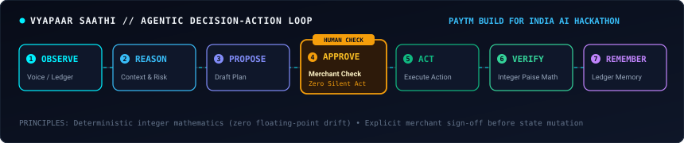
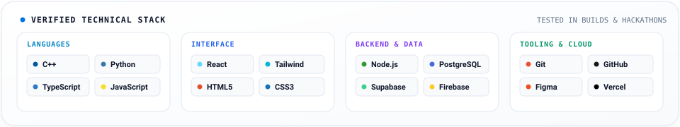

<!--
  ============================================================
  PRANAY KHODADE — MINIMAL PREMIUM × HIGH MOTION PORTFOLIO
  GitHub Profile Repository: pranaykhodade1922-dot/pranaykhodade1922-dot
  ============================================================
-->

  

  
  &nbsp;
  
  &nbsp;
  

  

### ✦ About

> Second-year **B.Tech student in Computer Science &amp; Engineering (Data Science)**.  
> I design and engineer practical digital products, focusing on **agentic AI systems**, **deterministic backend architectures**, and **responsive interfaces**. Rather than just writing syntax, I solve real-world friction points through clean code, rapid prototyping, and defensive engineering.

  

### ✦ Selected Works

<table>
  <tr>
    <td width="50%" valign="top">
      <h4>01 / Vyapaar Saathi</h4>
      
<b>Voice-first AI financial teammate for small merchants</b>

      
Autonomous 7-stage loop with human approval checkpoints and integer-paise precision to eliminate rounding drift.

      

        <code>Python</code> <code>AI Voice</code> <code>Integer Math</code> <code>Paytm Hackathon</code>
      

    </td>
    <td width="50%" valign="top">
      <h4>02 / TrustGuard AI</h4>
      
<b>AI trust, security &amp; verification architecture</b>

      
Defensive verification layer inspecting prompt boundaries and guarding LLM tool executions against untrusted inputs.

      

        <code>Python</code> <code>AI Defense</code> <code>API Guardrails</code>
      

      

        <a href="https://github.com/pranaykhodade1922-dot/TrustGuard"><b>Explore Repository →</b></a>
      

    </td>
  </tr>
  <tr>
    <td width="50%" valign="top">
      <h4>03 / CampusKhulasa</h4>
      
<b>Student transparency platform &amp; community</b>

      
Campus updates and authentic student engagement with a live, responsive pre-launch onboarding waitlist.

      

        <code>React</code> <code>Tailwind CSS</code> <code>Vercel</code>
      

      

        <a href="https://campuskhulasa-waitlist.vercel.app/"><b>Visit Live Platform →</b></a>
      

    </td>
    <td width="50%" valign="top">
      <h4>04 / RazorGuard-AI</h4>
      
<b>Payment flow security &amp; threat mitigation</b>

      
Modular anomaly detection heuristics and defensive gateway patterns formulated for the Razorpay AI Buildathon 2026.

      

        <code>Security Engineering</code> <code>Node.js</code> <code>Payment Defense</code>
      

    </td>
  </tr>
</table>

  

  <b>Additional Engineering &amp; Open Source:</b>  
  <a href="https://github.com/pranaykhodade1922-dot"><b>KumbhMitra</b></a> (Android Kotlin/Jetpack Compose concept for Nashik Kumbh 2026) · 
  <a href="https://github.com/pranaykhodade1922-dot/Trading-Bot"><b>Trading Bot</b></a> (Binance Futures Testnet Python engine with dry-run mode) · 
  <a href="https://github.com/NxtLabTech/TravelPlanner/pull/28"><b>TravelPlanner PR #28</b></a> (Open-source mobile viewport responsiveness patch)

  

### ✦ Technical Stack

  

  

### ✦ Activity &amp; Contributions

  
  &nbsp;
  

  <picture>
    <source media="(prefers-color-scheme: dark)" srcset="https://raw.githubusercontent.com/pranaykhodade1922-dot/pranaykhodade1922-dot/output/github-contribution-grid-snake-dark.svg" />
    <source media="(prefers-color-scheme: light)" srcset="https://raw.githubusercontent.com/pranaykhodade1922-dot/pranaykhodade1922-dot/output/github-contribution-grid-snake.svg" />
    
  </picture>

  

### ✦ Connect

  
  &nbsp;&nbsp;
  
  &nbsp;&nbsp;
  

  Designed with precision · <b>Pranay Khodade</b> · 2026

