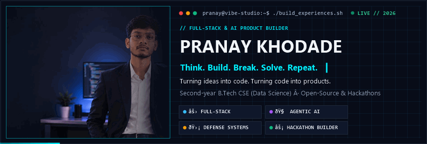
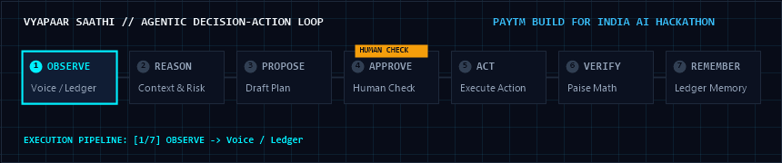
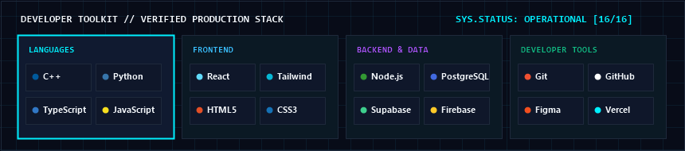

<!--
  ============================================================
  PRANAY KHODADE — DEVELOPER / VIBE CODER IDENTITY (V2)
  GitHub Profile Repository: pranaykhodade1922-dot/pranaykhodade1922-dot
  ============================================================
-->

  

  
  &nbsp;
  
  &nbsp;
  
  &nbsp;
  

## ⚡ Developer Identity

<table>
  <tr>
    <td width="220" align="center" valign="top">
       
      
        
      <b>Pranay Khodade</b> 
      2nd-Year B.Tech CSE (Data Science) 
      Pune / India
        
      
    </td>
    <td valign="top">
      <h3>// Think. Build. Break. Solve. Repeat.</h3>
      

        I am a <b>full-stack developer, AI product builder, and creative problem solver</b>. I love taking ambiguous, real-world friction points—from local merchant bookkeeping to AI prompt security—and turning them into dependable, working software.
      

      <ul>
        <li><b>Vibe &amp; Execution:</b> Fast prototyping backed by rigorous architecture. I build, break, fix, and ship.</li>
        <li><b>Deterministic Systems:</b> Heavy backend logic with integer-paise arithmetic to eliminate floating-point financial drift.</li>
        <li><b>Human-Centric AI:</b> Designing autonomous agentic loops with explicit human approval checkpoints before state changes.</li>
        <li><b>Competitive &amp; Open Source:</b> Paytm Build For India AI Hackathon (Mumbai), Razorpay AI Buildathon 2026, and open-source contributions.</li>
      </ul>
    </td>
  </tr>
</table>

## 🚀 Featured Projects

<table>
  <tr>
    <td width="50%" valign="top">
      <h4>01 / Vyapaar Saathi</h4>
      
<b>Voice-First AI Financial Teammate for Small Merchants</b>

      
Autonomous 7-stage loop with vernacular voice recognition, zero silent state changes, and integer-paise calculations.

      

        <code>Python</code> <code>AI Voice</code> <code>Integer Math</code> <code>Paytm Hackathon</code>
      

    </td>
    <td width="50%" valign="top">
      <h4>02 / TrustGuard AI</h4>
      
<b>AI Trust, Verification &amp; Security Architecture</b>

      
Defensive verification layer inspecting prompt boundaries and guarding LLM tool executions against untrusted inputs.

      

        <code>Python</code> <code>AI Defense</code> <code>Security Guardrails</code>
      

      

        <a href="https://github.com/pranaykhodade1922-dot/TrustGuard"><b>Explore Repository →</b></a>
      

    </td>
  </tr>
  <tr>
    <td width="50%" valign="top">
      <h4>03 / CampusKhulasa</h4>
      
<b>Student Transparency Platform &amp; Waitlist</b>

      
Verified campus community platform featuring an active, high-conversion responsive onboarding waitlist.

      

        <code>React</code> <code>Tailwind CSS</code> <code>Vercel</code>
      

      

        <a href="https://campuskhulasa-waitlist.vercel.app/"><b>Visit Live Platform →</b></a>
      

    </td>
    <td width="50%" valign="top">
      <h4>04 / RazorGuard-AI</h4>
      
<b>Payment Security &amp; Workflow Threat Defense</b>

      
Layered API defense patterns and real-time transaction anomaly scoring engineered for the Razorpay AI Buildathon 2026.

      

        <code>Security Engineering</code> <code>Node.js</code> <code>Payment Defense</code>
      

    </td>
  </tr>
</table>

  

  <b>Additional Engineering &amp; Open Source:</b> 
  • <a href="https://github.com/pranaykhodade1922-dot"><b>KumbhMitra:</b></a> Native Android (Kotlin + Jetpack Compose) pilgrim assistance concept for Nashik Kumbh 2026. 
  • <a href="https://github.com/pranaykhodade1922-dot/Trading-Bot"><b>Algorithmic Trading Bot:</b></a> Python engine strictly built for Binance Futures Testnet simulation with dedicated dry-run mode. 
  • <a href="https://github.com/NxtLabTech/TravelPlanner/pull/28"><b>TravelPlanner (PR #28):</b></a> Upstream open-source contribution resolving mobile viewport responsiveness on trip details.

## 🛠 Developer Toolkit

  

## 📊 Activity &amp; Contributions

  
  &nbsp;
  

### 🐍 Real-Time Contribution Snake

  <picture>
    <source media="(prefers-color-scheme: dark)" srcset="https://raw.githubusercontent.com/pranaykhodade1922-dot/pranaykhodade1922-dot/output/github-contribution-grid-snake-dark.svg" />
    <source media="(prefers-color-scheme: light)" srcset="https://raw.githubusercontent.com/pranaykhodade1922-dot/pranaykhodade1922-dot/output/github-contribution-grid-snake.svg" />
    
  </picture>

## 🤝 Builder Spotlight &amp; Connect

<table>
  <tr>
    <td width="200" align="center" valign="middle">
      
    </td>
    <td valign="middle">
      <h3>Let's build something impactful.</h3>
      

        Always looking to collaborate on ambitious products, hackathons, and innovative open-source architectures.
      

      

        
        &nbsp;&nbsp;
        
        &nbsp;&nbsp;
        
      

    </td>
  </tr>
</table>

  Engineered by <b>Pranay Khodade</b> · Think. Build. Break. Solve. Repeat.

